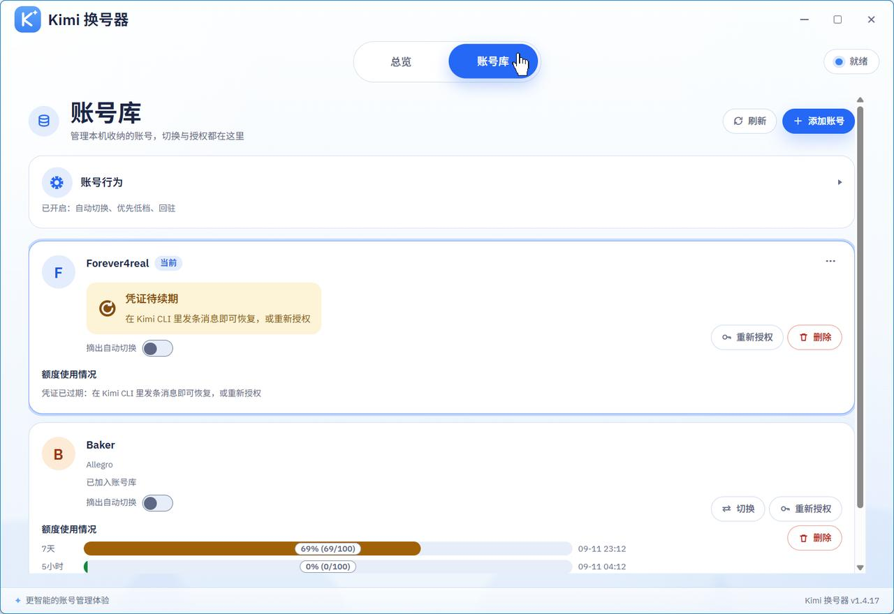

# kimi-switch · Kimi 换号器

[Kimi Code](https://www.kimi.com/) 多账号管理工具：浏览器授权添加账号、一键切换、额度一目了然。
以 Windows 为主：图形界面和命令行两个版本，单文件 exe、无运行时依赖。



## 功能

- **浏览器授权添加账号**：点「＋ 添加账号」获取授权链接，在浏览器登录授权后自动入库（设备码授权），全程不影响当前正在使用的账号。
- **按卡重新授权**：账号过期不用删除重加——点卡片上的「重新授权」对这一张卡重走设备码授权；官方身份对不上会被拒绝，凭证不会写错卡。
- **一键切换账号**：点「切换」原子替换 `~/.kimi-code/credentials/kimi-code.json`，**无需退出重登、无需重启**，立即生效。切换本身是纯本地毫秒级操作、不依赖网络——点完界面立即恢复可用、所点卡片立即成为当前账号，额度数字后台补齐，期间可以继续再切。写入后回读校验身份，写错当场回滚；写入具备掉电持久性；切到已失效的凭证照常切换成功、但立刻提示「该账号凭证已失效，建议重新授权」。每次切换自动留快照，失败可回滚。
- **导入当前账号**：把本机 Kimi Code 已登录的账号一键收进账号库。已绑定网页登录的卡会顺带重读会员到期，失败不影响导入。
- **Edge 免粘贴绑定（Windows GUI）**：在账号卡上点「从 Edge 自动读取并绑定」，软件打开带一次性挑战的 Kimi 控制台，配套扩展只在这次挑战页面读取网页 `access_token` 并交给本机绑定管道。扩展未安装、未登录、超时或策略阻断时仍可手动粘贴；CLI 继续从 stdin 读取。该路径当前仍需目标 Edge 的真实交接验收。
- **额度可视化**：5 小时 / 7 天双窗口彩色进度条（绿 → 黄 → 橙 → 红），条上直接标注百分比与用量，右侧显示窗口重置时间（如 `09-03 09:25`），附带官网会员档位名（Allegretto、Allegro 等）。后台静默查询（最小化/隐藏时照常）：常态 90 秒；当前账号用量达到 80% 加密到 30 秒、达到 95% 加密到 10 秒（10 秒为下限；加密只针对当前账号，其他账号维持 90 秒节奏）；有凭证待续期行时 5 秒（优先于适应性档位），无恢复信号则不打用量接口；点「刷新」做用户发起的额度查询（约 5 秒连点不打网；429 仍退避；凭证待续期 / 401 / 403 会直查）。陈旧回退时卡片标注缓存时间。额度告急只看用量窗口已用 ≥ 80%，查询失败不算告急。
- **会员到期**：绑定网页登录后，额度 stack 底部出现一条与额度条同外形的会员轨道：左「会员」、中「剩余 N 天 / 今天到期 / 已过期 N 天」徽章、右到期日 `YYYY-MM-DD`（东八区，与官网一致）。轨道按真实会员周期画「已度过比例」填充（周期 = 到期日 − 官网订阅的开始日，月付/年付自动区分），颜色随剩余天数绿 → 黄 → 橙 → 红，周期最后一天走满、过期后保持满条；不是用量压力，不计告急。周期起点由绑定/刷新管道写入；老绑定在没有真实起点前按档位近似显示（年档 ≈365 天、月档 ≈30 天），重新绑定后自动切回精确值。未绑定只在档位旁给弱提示；点「刷新」会对已绑定卡重读到期日，失败时轨道仍用缓存日期，按钮改为「重新绑定」，并弹瞬时提示。CLI 列表仍打印「有效期至」。
- **账号状态汇总**：总览页当前账号卡底部常驻健康条——无额度告急、无凭证待续期、无查询失败时显示绿色「账号状态正常」；任一异常时同位置换成对应提示（账号额度告急 / 凭证待续期 / 额度查询失败）。只读已收集的额度快照，不新增网络请求。
- **凭证待续期引导**：当前账号 access token 过期导致的 401 单独标成「凭证待续期」——不算额度告急、不按错误红渲染，并提示恢复路径（在 Kimi CLI 里发条消息，或对这张卡重新授权）。发消息后官方重写当前登录文件即恢复信号：静默约 5 秒内自动重查，点「刷新」立即直查；待续期行消失时弹一次「凭证已恢复」。
- **当前账号主动续期（可选）**：账号库页顶部「账号行为」面板的开关，默认关闭、仅 Windows 生效；开启后在查询额度前为当前账号原子轮换登录凭证，不等官方客户端的懒刷新；极端情况下官方会话可能要求重新登录。
- **额度耗尽自动切换（可选）**：账号库页顶部「账号行为」面板的开关，默认关闭。开启后，每次静默额度查询完成（节奏见「额度可视化」：常态 90 秒，当前账号用量高时自动加密；GUI 最小化不暂停）会检查当前账号：任一用量窗口已用达到阈值（默认 99%）就自动切到合格停泊账号（默认按已用比例升序），并弹瞬时通知。另有四个子开关「自动切换时优先低档位账号」「额度恢复后回驻低档账号」「pace 预切换」「重置前抢用」，均默认关闭，与主开关、主动续期一起收在「账号行为」一层折叠里（默认收起，不因任一开关已开而自动展开；收起时标题下用一行文字写明当前生效项，全关则不写）；总开关关闭时子开关置灰、不清已选状态。开启「回驻」后，当前账号未耗尽但存在档位严格更低的合格停泊账号时，自动切回其中档位最低者（须连续两个合格快照周期才切回；档位未知的账号不作为回驻目标）；手动切换后 8 小时保持期内不回驻，耗尽被迫切换不受影响；回驻与耗尽切换共用冷却。开启「pace 预切换」后，当前账号未达耗尽阈值、但按当前用量速度预测撑不到窗口重置时，提前切到更健康的停泊账号。开启「重置前抢用」后，未达耗尽、pace 未命中时，若合格停泊账号的 5 小时窗处于最后一小时或 7 天窗处于最后两天、且该窗口已用超过 70%，会自动切过去烧尾巴，烧完（窗口翻过重置点或目标达耗尽阈值）再切回原账号；燃烧期间 pace 与回驻不打断。账号卡上可「摘出自动切换」：被摘出的号不当耗尽 / pace / 回驻 / 抢用候选，手动切换仍可用；本地已确认失效（官方拒绝过其续期）的账号同样不当自动切换候选，但手动切过去仍会成功（带「建议重新授权」提示）。查询失败、数据未知、凭证待续期不触发轮询判定；刚手动选的号约 60 秒内不会被轮询切走（例外见下面的被动切换）；两次自动切换之间有冷却。进阶排序 / 防抖 / pace 预警水位 / 抢用水位与临近窗口只在 `config.toml` 的 `[auto_swap]`，默认关或零变化。CLI 无参列表同样会判定并追加一行英文结果。
- **配额失败被动切换（可选，须装 hook）**：「额度耗尽自动切换」开着且安装了 hook（命令行执行 `kimi-switch-cli install-hook`）时，Kimi Code 会话实际撞上额度耗尽（官方现为 429 "You've reached your … usage limit"，旧版的 403 也认）的那一刻，官方 StopFailure hook 秒级唤起切换——失败请求间隙从分钟级降到秒级，过载、请求过多、并发上限这类不是额度耗尽的 429 不会误触发；GUI 没开也有兜底（hook 唤起的是独立 CLI 进程，不弹窗、绝不打断会话）。`install-hook` 幂等、只写入自己的条目、不动 `~/.kimi-code/config.toml` 里其他内容；`kimi-switch-cli install-hook --uninstall` 可还原。冷却、合格线、防抖边际、摘出等与轮询切换一致；刚手动选的号仍可能被立刻切走（安顿宽限不挡这次切换）。
- **账号管理**：官方昵称已知的账号卡片直接显示官网名、无「重命名」入口；昵称未知的账号仍可起别名。删除带确认弹窗。
- **凭证安全**：token 只保存在本机私有目录（Unix 下 0600 权限），网络请求只发往 Kimi 官方域名（`auth.kimi.com` / `api.kimi.com` / `www.kimi.com`，其中 `www.kimi.com` 仅限会员到期读取：绑定、用户点刷新、已绑定卡的导入补读；静默查询不打该接口），零遥测；token 刷新在有官方锁协议的平台（macOS/Linux）与官方客户端用同一套锁协调；Windows 上官方无锁协议，默认不替当前账号续期、不会互相抢刷（可选「主动续期」见上文）。

## 安装

### 下载成品

从 [Releases](../../releases) 下载 `kimi-switch.exe`（图形界面）或 `kimi-switch-cli.exe`（命令行），双击即用。

### 从源码构建

需要 Rust 1.80+ 和 Node.js（图形界面）：

```bash
git clone https://github.com/yuan2627/kimi-switch.git
cd kimi-switch
cargo build --release -p kimi-switch-cli
npm install
npm run tauri build
```

产物：`target/release/kimi-switch.exe`（图形界面）、`target/release/kimi-switch-cli.exe`（命令行）、`target/release/bundle/`（MSI/NSIS 安装包）。

Windows 上更新桌面快捷方式指向的本地 GUI 时，先退出正在运行的 `kimi-switch.exe`，再运行 `npm run build:desktop`。该命令会先完成前端检查，若目标程序仍在运行会明确报错，成功后更新固定路径 `target/release/kimi-switch.exe`，接着重建 `target/release/kimi-switch-cli.exe`。装过 hook 时，hook 调用的是执行 `install-hook` 时那个 `kimi-switch-cli.exe`（路径写在 `~/.kimi-code/config.toml` 里）：用这里 `target/release` 的 CLI 装的，被动切换随之用上新逻辑；用别处的 CLI 装的，要更新那份 exe，或用这里的 CLI 重新执行一次 `install-hook`（只刷新本工具那一条的路径）。

### Edge 扩展（Windows GUI）

免粘贴绑定需要手动加载项目内的私有扩展包：分发包即仓库内 `edge-extension/` 源码目录（三个纯文本文件，可直接审计，无构建/打包步骤）。安装（加载解压缩的扩展）、更新（重新加载）与撤销（`edge://extensions` 移除，等待中的挑战自动收口）步骤见 [`edge-extension/README.md`](edge-extension/README.md)。扩展只声明 Kimi 控制台页面和 `127.0.0.1` 回调权限，不读取 cookie、不扫描其他 profile，也不把网页 token 写入扩展存储；权限面由 `src-ui/edge-extension-contract.test.ts` 钉住。真实 Edge 交接、企业策略和 Local Network Access 尚未在目标机器核对；按 2026-09-23 的决定，这不再作为 #170 / #176 的关闭条件。本地测试不写成该项已通过。

## 使用

### 图形界面

双击 `kimi-switch.exe`：

| 操作 | 说明 |
|---|---|
| ＋ 添加账号 | 弹出授权链接 → 浏览器登录授权 → 自动入库 |
| 导入当前账号 | 把 Kimi Code 当前登录的账号存入账号库。已绑定网页登录的卡会顺带重读会员到期，失败不影响导入 |
| 切换 | 把该账号写入本地凭证，立即生效。点完界面立即恢复可用、所点卡片立即成为当前账号（切换本身不依赖网络），额度数字后台补齐、期间可继续再切；写入后回读校验、写错当场回滚；切到已失效凭证照常成功并附「该账号凭证已失效，建议重新授权」提示 |
| 重新授权 | 给这一张卡重走浏览器设备码授权，救活过期账号（当前账号卡上没有「切换」，只有「重新授权」） |
| 绑定 / 重新绑定 | 档位旁出现入口时：首选「从 Edge 自动读取并绑定」，由项目内扩展在本次挑战页面读取网页 token；扩展不可用时可手动粘贴。未绑定是「绑定」；网页登录失效后是「重新绑定」（覆盖旧网页 token，不是设备码「重新授权」） |
| 重命名 | 给尚未缓存官方昵称的账号起别名。昵称已知后卡片显示官网名，不再出现此入口 |
| 删除 | 从账号库移除（不影响 Kimi Code 当前登录文件） |
| 刷新 | 用户发起的额度查询，并对已绑定卡重读会员到期：约 5 秒内连点不打网，并提示「刚刚更新过」；超时/网络等可重试失败会再查；429 退避中提示「请求过于频繁，请稍后再试」；凭证待续期 / 401 / 403 会直查，恢复时弹一次「凭证已恢复」。若已绑定卡会员到期没刷出来，再弹一条普通提示「会员到期未更新：…」（多卡合并成一条），不常驻卡面。静默查询按适应性档位：常态 90 秒，当前账号用量达到 80% 加密到 30 秒、达到 95% 加密到 10 秒（只加密当前账号，其他号维持 90 秒），有待续期行时 5 秒；最小化/隐藏不暂停。静默不打网页会员接口、不弹会员提示。开启「额度耗尽自动切换」时，这次查询完成后也可能自动换号。 |
| 账号行为 · 额度耗尽自动切换 | 默认关。开启后额度查询完成即可能自动换号（默认按已用比例升序选合格停泊账号）；关着时行为与未装此功能时一致 |
| 账号行为 · 自动切换时优先低档位账号 | 默认关，收在「账号行为」一层折叠里。总开关关闭时置灰、不清已选状态。开启后自动切换先按会员档位从低到高，同档再按原排序 |
| 账号行为 · 额度恢复后回驻低档账号 | 默认关，收在「账号行为」一层折叠里。总开关关闭时置灰、不清已选状态。开启后当前账号未耗尽但存在档位严格更低的合格停泊账号时，自动切回其中档位最低者（连续两个合格快照周期才切回）；手动切换后 8 小时保持期内不回驻，耗尽被迫切换不受影响；与耗尽切换共用冷却 |
| 账号行为 · pace 预切换 | 默认关，收在「账号行为」一层折叠里。总开关关闭时置灰、不清已选状态。开启后当前账号未达耗尽阈值、但按当前用量速度预测撑不到窗口重置时，提前切到更健康的停泊账号；预警水位（默认 0.8）只在 `config.toml` 调 |
| 账号行为 · 重置前抢用 | 默认关，收在「账号行为」一层折叠里。总开关关闭时置灰、不清已选状态。开启后临近重置且该窗口已用超过水位的合格停泊账号会被切上去烧尾巴，烧完自动切回。水位与两个临近窗口时长只在 `config.toml` 调 |
| 摘出自动切换 | 账号卡上的开关，默认关。开启后该账号不作为耗尽 / pace / 回驻 / 抢用候选；点「切换」仍可用；它作为当前账号耗尽时仍会被自动切走 |

### 命令行

```bash
kimi-switch-cli                 # 账号列表 + 5h/7d 额度（带缓存节流与失败退避）；[auto_swap] 开启时列表后可能自动切换。退出码：0 已切换 / 1 错误 / 2 无事 / 3 达阈值无候选。`--json` 向 stdout 写行式事件（人类可读走 stderr）
kimi-switch-cli login kimi      # 导入当前 Kimi Code 已登录账号
kimi-switch-cli swap <编号或id>  # 切换激活账号
kimi-switch-cli rm <编号或id>    # 删除账号
kimi-switch-cli bind-web <编号或id>  # 从 stdin 读网页 token，绑定后列表显示有效期至
kimi-switch-cli config           # 打印生效设置（只读，与 GUI 同源）
kimi-switch-cli install-hook     # 安装配额失败被动切换 hook（写入 ~/.kimi-code/config.toml 的 StopFailure 条目，幂等；--uninstall 还原）
```

被动切换子命令 `on-quota-failure` 由 hook 自动唤起，无需（也不应）手动执行；它任何情况下都以退出码 0 结束，绝不打断 Kimi Code 会话。每次唤起都会在审计日志（见下方「数据目录」）追加一行 `on_quota_failure` 记录：事件名、命中的口径或未命中的原因、最终决定（切到哪个账号，或不切的原因）；不记会话标题、工作目录和错误原文。

GUI 与 CLI 共用同一份账号库和设置，可以混用。

### 数据目录

本工具以 Windows 为主。默认目录：

- 配置（账号库 `registry.toml`、设置 `config.toml`）：`%APPDATA%\kimi-switch\kimi-switch\config`
- 数据（凭证 `credentials.json`、审计日志）：`%APPDATA%\kimi-switch\kimi-switch\data`
- 缓存（额度查询缓存）：`%LOCALAPPDATA%\kimi-switch\kimi-switch\cache`

也可设置绝对路径环境变量 `KIMI_SWITCH_HOME`，把配置、数据、状态与缓存全部收口到该目录下的 `config` / `data` / `cache`。

## 常见问题

**切换后需要重启 Kimi Code 吗？**
不需要。凭证是每次请求时读取的，切换即时生效。

**账号库的凭证安全吗？**
所有 token 只存在你自己的电脑上（`%APPDATA%\kimi-switch\kimi-switch\data` 下的私有文件），不会上传到任何第三方服务器。源码中唯一的网络请求发往 Kimi 官方域名：授权、额度与官方昵称走 `auth.kimi.com` / `api.kimi.com`，会员到期读取才访问 `www.kimi.com`（绑定、用户点刷新、已绑定卡的导入补读；静默查询不打该接口）。

**账号放久了切换过去提示 401？**
refresh token 有有效期，长期未使用的账号凭证会过期。在账号库对那张卡点「重新授权」重走一次浏览器登录即可救活，无需删除重加。

**当前账号额度查询提示 401，其他账号却正常？**
当前账号的额度查询直接使用 Kimi Code 当前登录文件里的 access token，它只有约 15 分钟有效期，官方客户端闲置时不会自动续期；本工具默认不替当前账号续期，避免与官方客户端争抢凭证。这种情况会单独标成「凭证待续期」：在 Kimi CLI 里发一条消息（触发官方续期）后，点「刷新」会立刻直查，或等静默约 5 秒自动重查；待续期消失时弹「凭证已恢复」。若仍反复 401，再对这张卡点「重新授权」重走登录。Windows 用户也可以在账号库页「账号行为」面板打开「当前账号主动续期」，让工具在查询前自动轮换凭证。

**打开「额度耗尽自动切换」后，没开 kimi-switch 也会换号吗？**
分两种：装了 hook 会，没装不会。默认不装：GUI 运行时静默查询会判定（默认 90 秒、当前账号用量高时自动加密到 30/10 秒，最小化不暂停），CLI 无参列表时也会。执行过 `kimi-switch-cli install-hook` 后，即使 GUI 没开，Kimi Code 会话撞上额度耗尽的那一刻也会由 hook 秒级唤起切换（见下一条）。手动「切换」始终可用，不依赖额度查询。

**Kimi Code 提示 "You've reached your … usage limit"（额度耗尽）时能自动换号吗？**
可以，这叫「配额失败被动切换」。前提：「额度耗尽自动切换」开着，且执行过一次 `kimi-switch-cli install-hook`（幂等；`--uninstall` 还原）。安装只写入 `~/.kimi-code/config.toml` 里属于本工具的一条 StopFailure hook，不动其他内容。命中条件是官方额度耗尽错误：同一条错误文案里同时有 "reached your" 和 "usage limit"，且这条错误本身带 429（5 小时、7 天、月度三种耗尽文案都是这样）；旧版 Kimi Code 报的 403 + "usage limit" 也照样识别。会话标题（你的首句提示）和工作目录不参与识别，在提示里贴报错文案排查不会误触发。过载、请求过多、并发上限这类不是额度耗尽的 429 不会误触发；切换不新增任何网络请求，冷却与候选合格线和轮询切换一致，但安顿宽限不挡这次切换；多个会话同时撞上额度耗尽只切一次；刚因额度耗尽被切走的账号，在恢复之前（缓存里该窗口的重置时刻，没有就按窗口时长估计）不会被自动切回，手动切换不受影响；hook 绝不打断你的会话。撞上了却没切换时，原因记在审计日志的 `on_quota_failure` 行里；原因是 `superseded` 表示决定切换之后、真正切换之前，你已手动切了账号或另一次切换刚刚完成，这次就放弃，不覆盖你的选择。

## 免责声明

本工具为个人开源项目，与 Moonshot AI / Kimi 官方无关。多账号使用方式可能涉及官方服务条款的灰色地带，请自行评估风险，账号安全与使用后果自负。本项目仅供学习交流。

## License

[MIT](LICENSE)
