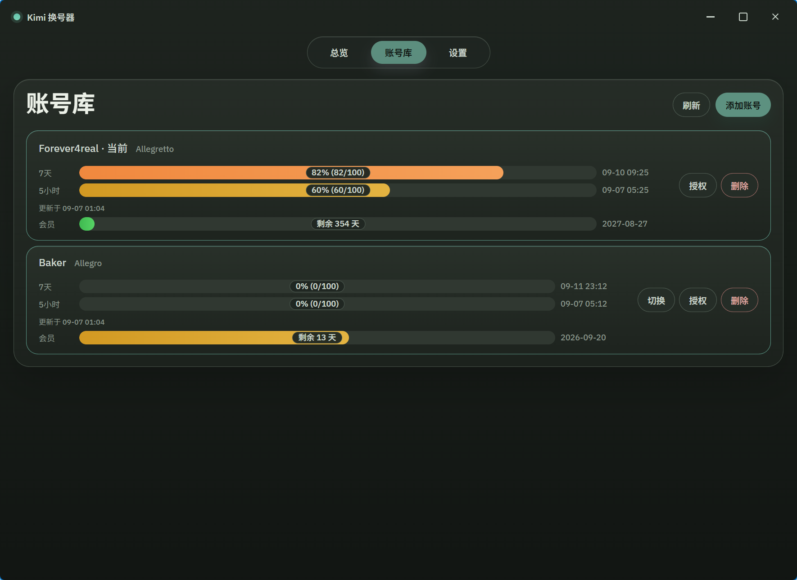
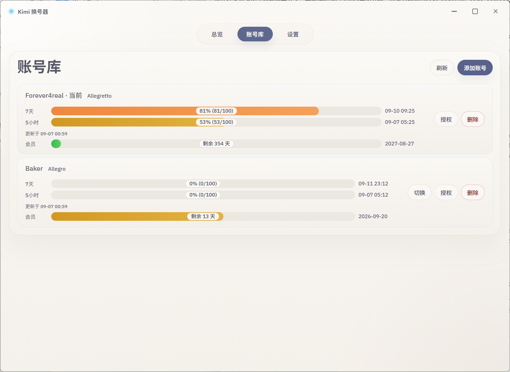

# kimi-switch · Kimi 换号器

[Kimi Code](https://www.kimi.com/) 多账号管理工具：浏览器授权添加账号、一键切换、额度一目了然。
以 Windows 为主：图形界面和命令行两个版本，单文件 exe、无运行时依赖。





## 功能

- **浏览器授权添加账号**：点「＋ 添加账号」获取授权链接，在浏览器登录授权后自动入库（设备码授权），全程不影响当前正在使用的账号。
- **按卡重新授权**：账号过期不用删除重加——点卡片上的「授权」对这一张卡重走设备码授权；官方身份对不上会被拒绝，凭证不会写错卡。
- **一键切换账号**：点「切换」原子替换 `~/.kimi-code/credentials/kimi-code.json`，**无需退出重登、无需重启**，立即生效；每次切换自动留快照，失败可回滚。
- **导入当前账号**：把本机 Kimi Code 已登录的账号一键收进账号库。
- **额度可视化**：5 小时 / 7 天双窗口彩色进度条（绿 → 黄 → 橙 → 红），条上直接标注百分比与用量，右侧显示窗口重置时间（如 `09-03 09:25`），附带官网会员档位名（Allegretto、Allegro 等）。窗口可见时静默查询（90 秒）；点「刷新」做用户发起的额度查询（约 5 秒连点不打网；429 / 凭证待续期仍退避），陈旧回退时卡片标注缓存时间。额度告急只看用量窗口已用 ≥ 80%，查询失败不算告急。
- **会员到期**：绑定网页登录后，额度 stack 底部出现一条与额度条同外形的会员轨道：左「会员」、中「剩余 N 天 / 今天到期 / 已过期 N 天」徽章、右到期日 `YYYY-MM-DD`（东八区，与官网一致）。轨道按真实会员周期画「已度过比例」填充（周期 = 到期日 − 官网订阅的开始日，月付/年付自动区分），颜色随剩余天数绿 → 黄 → 橙 → 红，周期最后一天走满、过期后保持满条；不是用量压力，不计告急。周期起点由绑定/刷新管道写入；老绑定在没有真实起点前按档位近似显示（年档 ≈365 天、月档 ≈30 天），重新绑定后自动切回精确值。未绑定只在档位旁给弱提示；点「刷新」会对已绑定卡重读到期日，失败时轨道仍用缓存日期，按钮改为「重新绑定」，并弹瞬时提示。CLI 列表仍打印「有效期至」。
- **凭证待续期引导**：当前账号 access token 过期导致的 401 单独标成「凭证待续期」——不算额度告急、不按错误红渲染，并提示恢复路径（在 Kimi CLI 里发条消息，或对这张卡重新授权）。
- **当前账号主动续期（可选）**：设置页开关，默认关闭、仅 Windows 生效；开启后在查询额度前为当前账号原子轮换登录凭证，不等官方客户端的懒刷新；极端情况下官方会话可能要求重新登录。
- **额度耗尽自动切换（可选）**：设置页开关，默认关闭。开启后，GUI 窗口开着时每次额度查询完成（含 90 秒静默）会检查当前账号：任一用量窗口已用达到阈值（默认 99%）就自动切到合格停泊账号（默认按已用比例升序），并弹瞬时通知。另有子开关「自动切换时优先低档位账号」，默认关闭；总开关关闭时该子开关置灰可见、不清已选状态。查询失败、数据未知、凭证待续期不切；刚手动选的号约 60 秒内不会被切走；两次自动切换之间有冷却。工具没在运行时不会切。也可直接改 `config.toml` 的 `[auto_swap]`。CLI 无参列表同样会判定并追加一行英文结果。
- **账号管理**：官方昵称已知的账号卡片直接显示官网名、无「重命名」入口；昵称未知的账号仍可起别名。删除带确认弹窗。
- **纸色 / 深色主题**：默认暖纸色，设置里可换成 jade-night 深色。
- **凭证安全**：token 只保存在本机私有目录（Unix 下 0600 权限），网络请求只发往 Kimi 官方域名（`auth.kimi.com` / `api.kimi.com` / `www.kimi.com`，其中 `www.kimi.com` 仅限绑定网页登录以读取会员到期），零遥测；token 刷新在有官方锁协议的平台（macOS/Linux）与官方客户端用同一套锁协调；Windows 上官方无锁协议，默认不替当前账号续期、不会互相抢刷（可选「主动续期」见上文）。

## 安装

### 下载成品

从 [Releases](../../releases) 下载 `kimi-switch.exe`（图形界面）或 `kimi-switch-cli.exe`（命令行），双击即用。

### 从源码构建

需要 Rust 1.80+ 和 Node.js（图形界面）：

```bash
git clone https://github.com/yuan2627/kimi-switch.git
cd kimi-switch
cargo build --release -p kimi-switch-cli
npm install
npm run tauri build
```

产物：`target/release/kimi-switch.exe`（图形界面）、`target/release/kimi-switch-cli.exe`（命令行）、`target/release/bundle/`（MSI/NSIS 安装包）。

## 使用

### 图形界面

双击 `kimi-switch.exe`：

| 操作 | 说明 |
|---|---|
| ＋ 添加账号 | 弹出授权链接 → 浏览器登录授权 → 自动入库 |
| 导入当前账号 | 把 Kimi Code 当前登录的账号存入账号库 |
| 切换 | 把该账号写入本地凭证，立即生效 |
| 授权 | 给这一张卡重走浏览器设备码授权，救活过期账号（当前账号卡上没有「切换」，只有「授权」） |
| 绑定 / 重新绑定 | 档位旁出现入口时：粘贴该账号的网页登录 token。从未绑定是「绑定」；网页登录失效后是「重新绑定」（覆盖旧网页 token，不是设备码「授权」） |
| 重命名 | 给尚未缓存官方昵称的账号起别名。昵称已知后卡片显示官网名，不再出现此入口 |
| 删除 | 从账号库移除（不影响 Kimi Code 当前登录文件） |
| 刷新 | 用户发起的额度查询，并对已绑定卡重读会员到期：约 5 秒内连点不打网，并提示「刚刚更新过」；超时/网络等可重试失败会再查；429 退避中提示「请求过于频繁，请稍后再试」；凭证待续期 / 401 / 403 不打网、不另弹提示。若已绑定卡会员到期没刷出来，再弹一条普通提示「会员有效期未更新：…」（多卡合并成一条），不常驻卡面。启动与静默仍 90 秒，静默不打网页会员接口、不弹这条会员提示。开启「额度耗尽自动切换」时，这次查询完成后也可能自动换号。 |
| 设置 · 额度耗尽自动切换 | 默认关。开启后额度查询完成即可能自动换号（默认按已用比例升序选合格停泊账号）；关着时行为与未装此功能时一致 |
| 设置 · 自动切换时优先低档位账号 | 默认关。总开关关闭时置灰可见、不清已选状态。开启后自动切换先按会员档位从低到高，同档再按原排序 |

### 命令行

```bash
kimi-switch-cli                 # 账号列表 + 5h/7d 额度（带缓存节流与失败退避）；[auto_swap] 开启时列表后可能自动切换
kimi-switch-cli login kimi      # 导入当前 Kimi Code 已登录账号
kimi-switch-cli swap <编号或id>  # 切换激活账号
kimi-switch-cli rm <编号或id>    # 删除账号
kimi-switch-cli bind-web <编号或id>  # 从 stdin 读网页 token，绑定后列表显示有效期至
kimi-switch-cli config           # 打印生效设置（只读，与 GUI 设置页同源）
```

GUI 与 CLI 共用同一份账号库和设置，可以混用。

### 数据目录

本工具以 Windows 为主。默认目录：

- 配置（账号库 `registry.toml`、设置 `config.toml`）：`%APPDATA%\kimi-switch\kimi-switch\config`
- 数据（凭证 `credentials.json`、审计日志）：`%APPDATA%\kimi-switch\kimi-switch\data`
- 缓存（额度查询缓存）：`%LOCALAPPDATA%\kimi-switch\kimi-switch\cache`

也可设置绝对路径环境变量 `KIMI_SWITCH_HOME`，把配置、数据、状态与缓存全部收口到该目录下的 `config` / `data` / `cache`。

## 常见问题

**切换后需要重启 Kimi Code 吗？**
不需要。凭证是每次请求时读取的，切换即时生效。

**账号库的凭证安全吗？**
所有 token 只存在你自己的电脑上（`%APPDATA%\kimi-switch\kimi-switch\data` 下的私有文件），不会上传到任何第三方服务器。源码中唯一的网络请求发往 Kimi 官方域名：授权、额度与官方昵称走 `auth.kimi.com` / `api.kimi.com`，绑定网页登录读取会员到期才访问 `www.kimi.com`。

**账号放久了切换过去提示 401？**
refresh token 有有效期，长期未使用的账号凭证会过期。在账号库对那张卡点「授权」重走一次浏览器登录即可救活，无需删除重加。

**当前账号额度查询提示 401，其他账号却正常？**
当前账号的额度查询直接使用 Kimi Code 当前登录文件里的 access token，它只有约 15 分钟有效期，官方客户端闲置时不会自动续期；本工具默认不替当前账号续期，避免与官方客户端争抢凭证。这种情况会单独标成「凭证待续期」：在 Kimi CLI 里发一条消息（触发官方续期）后重新查询即可恢复；若仍反复 401，再对这张卡点「授权」重走登录。Windows 用户也可以在设置里打开「当前账号主动续期」，让工具在查询前自动轮换凭证。

**打开「额度耗尽自动切换」后，没开 kimi-switch 也会换号吗？**
不会。只有 GUI 窗口开着（含 90 秒静默查询），或你跑了 CLI 无参列表时才会判定。手动「切换」始终可用，不依赖额度查询。

## 免责声明

本工具为个人开源项目，与 Moonshot AI / Kimi 官方无关。多账号使用方式可能涉及官方服务条款的灰色地带，请自行评估风险，账号安全与使用后果自负。本项目仅供学习交流。

## License

[MIT](LICENSE)
